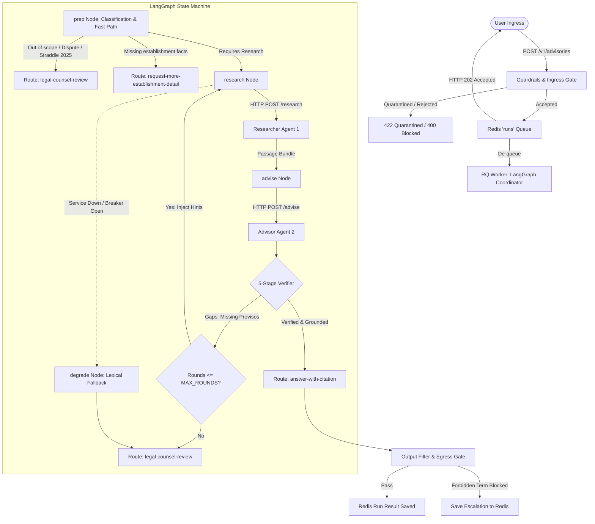

# Workplace Compliance Advisory Desk (Mini Project 09)
## Comprehensive Technical Architecture & Working Guide

---

## 1. Executive Summary & Problem Formulation

The **Workplace Compliance Advisory Desk** is an enterprise-grade multi-agent AI system designed to answer complex Indian human resources and labor compliance queries (specifically focusing on **Gratuity**, **Maternity Benefit**, and **Workplace Sexual Harassment / POSH**).

Unlike generic LLM wrappers that generate hallucinations or offer unauthorized legal opinions, this system operates under a **deterministic zero-hallucination mandate**:
- Every statutory assertion **must cite an in-force legal provision** retrieved directly from the corpus.
- The system **never issues legal opinions** or binding legal determinations.
- If a statutory provision is modified by provisos, **the verifier refuses to approve any answer unless all attached provisos and explanations have been retrieved and evaluated**.
- If statutory facts are missing or provisions conflict, the system **decisively escalates to human legal counsel**.

---

### The Benchmark "Hard Case": 18-Month Fixed-Term Contract Gratuity

Consider the canonical test case from the project specification:
> *"An employee engaged after 21 November 2025 on a written fixed-term contract of 18 months has completed the contract. Is gratuity payable?"*

#### Why Standard RAG / LLM Architectures Fail:
1. **The General Rule Trap:** Section 53(1) of the *Code on Social Security, 2020 (CoSS 2020)* states that gratuity is payable upon termination of employment after rendering continuous service for not less than **5 years**. Naive retrieval systems fetch this rule and answer incorrectly: *"No, gratuity is not payable because 18 months is less than 5 years."*
2. **The Hidden Statutory Proviso:** The first proviso to Section 53(1) creates an explicit exception:
   > *"Provided that the completion of continuous service of five years shall not be necessary where the termination of the employment of any employee is due to... expiration of fixed term contract..."*
3. **The Multi-Agent Solution:**
   - **Section-Aware Chunking:** Provisos are indexed with context links to their main rule (`has_provisos=True`).
   - **Proviso Retrieval Tooling:** The Researcher Agent is equipped with a `get_provisions` tool to expand all provisos of a cited section.
   - **The 5-Stage Complete Verifier:** The Verifier audits the draft advisory and rejects any citation to a general rule whose provisos were not retrieved. It injects an executable hint: `call get_provisions('coss_2020:s53')`, forcing a second research round until the fixed-term exception is evaluated.

---

## 2. System Architecture & Topology

The desk is structured into clean, decoupled microservices connected over HTTP and asynchronous Redis queues:

```
[ Browser / Web UI / cURL ]
           │
           ▼
     ┌───────────┐         ┌────────────────────────┐
     │ api:8000  │────────►│ redis:6379             │
     │ (FastAPI) │         │ - RQ job queue ('runs')│
     └───────────┘         │ - Shared circuit state │
           ▲               │ - Full-run result cache│
           │ poll 202      │ - Rate limit windows   │
           │               └────────────────────────┘
           │                           ▲
           │                           │ de-queue
           │               ┌────────────────────────┐
           │               │ worker (RQ Runner)     │
           │               │ LangGraph Coordinator  │
           │               └────────────────────────┘
           │                    │             │
           │         HTTP call  │             │ HTTP call
           │                    ▼             ▼
           │     ┌─────────────────┐       ┌─────────────────┐
           │     │ researcher:8001 │       │ advisor:8002    │
           │     │ (Agent 1)       │       │ (Agent 2)       │
           │     │ - Tool loop     │       │ - Assertion syn.│
           │     │ - FAISS index   │       │ - Verifier (A3) │
           │     └─────────────────┘       └─────────────────┘
           │                    ▲             ▲
           │                    │             │ HTTP call
           │                    └──────┬──────┘
           │                           │
           │                           ▼
           │                ┌───────────────────────┐
           │                │ stub-llm / LLM:8080   │
           │                └───────────────────────┘
           ▼
[ Observability Stack ]
- Prometheus (9090): Latency histograms, breaker status, token metrics
- OpenTelemetry / Jaeger (16686): Distributed trace spans across services
- Grafana (3000): End-to-end system health & cost dashboard
```

---

## 3. Microservice Roles & Responsibilities

| Service | Technology | Primary Function |
| :--- | :--- | :--- |
| **`api`** | FastAPI, Uvicorn (Port 8000) | Validates incoming payloads, executes PII / prompt injection guardrails, checks rate limits, enqueues runs, and serves status/trace endpoints. |
| **`worker`** | Python, RQ, LangGraph | Pulls jobs from Redis, manages the coordinator state machine, orchestrates agent HTTP calls, and executes fallback degradation. |
| **`researcher`** | FastAPI, FAISS, BM25 (Port 8001) | **Agent 1**: Runs an autonomous ReAct loop to search the legal corpus, inspect statutory sections, and expand provisos. Never drafts advisories. |
| **`advisor`** | FastAPI, Pydantic (Port 8002) | **Agent 2**: Drafts cited assertions using *only* retrieved passages, then runs the multi-stage Verifier. Never performs retrieval. |
| **`redis`** | Redis Server (Port 6379) | High-speed in-memory store for task queues, run traces, distributed circuit breakers, and whole-run caches. |
| **`stub` / `llm`** | FastAPI / OpenAI API (Port 8080) | Provider for chat completions (deterministic stub for reproducible tests or cloud providers like OpenAI/Anthropic/Ollama). |
| **`indexer`** | Python CLI, FAISS | One-shot statutory parsing pipeline: decomposes Acts into section/sub-section/proviso chunks and builds the vector index. |

---

## 4. End-to-End Workflow & Cognitive Mechanics



### 1. Ingress Guardrails Gate (`app/guardrails.py`, `app/contracts.py`)
- **Schema & Cross-Field Validation:** Enforces dates (`end_date >= start_date`), reconciles contract months with dates (+/- 1 month), and validates employment types.
- **PII Scrubbing:** Blocks any request containing email addresses, phone numbers, or 12-digit Indian national identity numbers (Aadhaar).
- **Injection & Toxicity Detection:** Free-text queries are scanned for jailbreak keywords and prompt-override patterns (score >= 3.0 blocked) and toxic speech (score >= 2.0 blocked).

### 2. Fast-Path Pre-Routing (`prep` node in `app/coordinator.py`)
To prevent unnecessary LLM token spending and eliminate latency, the coordinator performs instant rule-based evaluations:
- **Out of Scope:** If the question does not pertain to gratuity, maternity, or harassment $\rightarrow$ Escalates to `legal-counsel-review`.
- **Termination Disputes:** Wrongful dismissal and labor court disputes $\rightarrow$ Escalates to `legal-counsel-review`.
- **Live Harassment Complaints:** Active POSH complaints $\rightarrow$ Escalates to `legal-counsel-review`.
- **Transitional Straddling:** Employment contracts starting before 21 Nov 2025 and continuing after $\rightarrow$ Escalates to `legal-counsel-review` (due to overlapping repealed Acts and savings provisions).
- **Missing Facts:** If establishment size or committee details are required $\rightarrow$ Routes to `request-more-establishment-detail`.

### 3. The Researcher Agent Loop (`app/agents/researcher_service.py`)
- Executes a bounded ReAct cycle (max 8 steps, max 10 tool calls, 90s deadline).
- Operates strictly defined tools:
  1. `search_corpus(query, strategy)`: Semantic FAISS vector search or lexical BM25 retrieval.
  2. `get_clause(chunk_id)`: Fetches an exact section chunk.
  3. `get_provisions(section_ref)`: Fetches all provisos and explanations under a section.
  4. `get_request_field(field)`: Reads structured attributes from the client's request.
- **Output:** Returns *only* a bundle of retrieved passages and execution traces.

### 4. The Complete Provision Verifier (`app/verify.py`)
The Advisor Agent drafts assertions, which are immediately audited by the deterministic Verifier across 5 criteria:
1. **Citation Check:** Every assertion must cite at least one statutory chunk ID.
2. **Resolution Check:** All cited chunk IDs must exist in the retrieved passages bundle.
3. **Temporal Validity Check:** The statute must be legally in force on the query's `as_of_date` (e.g., verifying 1972 Act vs 2020 Code).
4. **Substantive & Numerical Support:** Lexical overlap must satisfy $\tau \ge 0.45$. Every number appearing in the assertion must exist in the cited text (preventing numeric hallucinations).
5. **Completeness (Provisos & Explanations):** Every proviso attached to a cited sub-section must have been retrieved. If missing, the Verifier generates an executable hint (e.g., `call get_provisions('coss_2020:s53')`), triggering a second research round.

### 5. Exit Filter & Invariant Guarantee (`finalize` node)
- Output filter scans for unauthorized legal opinion phrasing (`"in my legal opinion"`, `"I hereby rule"`, `"you must terminate"`).
- **Core Invariant:** A run can **never** return `answer-with-citation` unless it has passed 100% of the verification checks. Otherwise, it is downgraded to `legal-counsel-review` with unverified evidence attached.

---

## 5. Retrieval & Legal Corpus Engineering

Standard text chunkers split text at arbitrary character boundaries, detaching provisos from the rules they modify. The desk solves this with **Section-Aware Chunking** (`app/corpus/chunker.py`):

1. **Statutory Hierarchy:** Decomposes documents into:
   - `Section` $\rightarrow$ `Sub-section` $\rightarrow$ `Main Clause` / `Provisos` / `Explanations`
   - Example chunk ID: `coss_2020:s53:1:proviso1`
2. **Proviso Context Prefixing:** Provisos are embedded along with the main rule they qualify:
   ```
   [Code on Social Security, 2020 | s.53(1) | Payment of Gratuity | proviso 1]
   Qualifies the rule that says: Gratuity shall be payable to an employee on the termination of his employment after he has rendered continuous service for not less than five years --
   Provided that the completion of continuous service of five years shall not be necessary where the termination of the employment of any employee is due to expiration of fixed term contract...
   ```
   This ensures vector search matches queries asking about fixed-term contracts directly to the proviso!
3. **Linkage Attributes:** Main rule chunks maintain metadata:
   - `has_provisos: 1`
   - `proviso_ids: ["coss_2020:s53:1:proviso1"]`
   Alerting agents immediately that qualifications exist.

---

## 6. Resilience, Caching & Performance Optimization

### Distributed Circuit Breaker (`app/resilience.py`)
- Coordinates breaker state across all worker processes using Redis keys.
- If an agent or LLM fails 3 consecutive times within 60 seconds, the breaker opens for a 30-second cooldown.
- Prevents cascading timeouts by failing fast to `degraded` mode.

### Three-Tiered Caching Hierarchy
1. **Embedding LRU Cache:** In-memory vector embedding cache.
2. **Retrieval Cache:** Redis cache for FAISS/BM25 queries keyed by `(query, strategy, domain, index_version)`.
3. **Full-Run Advisory Cache:** Caches completed verified advisories keyed by normalized request facts + prompt version + model ID (1-hour TTL).
   - Identical queries return in **< 20 ms** and cost **0 LLM tokens**.

---

## 7. REST API Endpoints Reference

The desk is fully documented via Swagger / OpenAPI at `http://localhost:8000/docs`.

| Endpoint | Method | Status | Description |
| :--- | :---: | :---: | :--- |
| `/v1/advisories` | `POST` | `202 Accepted` | Submits an advisory question; returns `run_id` and `status_url`. |
| `/v1/advisories/{id}` | `GET` | `200 OK` | Retrieves run status, route, advisory, citations, and escalation details. |
| `/v1/advisories/{id}/trace` | `GET` | `200 OK` | Delivers the full audit trace (every step, tool call, query, and verifier check). |
| `/v1/feedback` | `POST` | `201 Created` | Submits human reviewer ratings (`satisfactory` / `unsatisfactory`) and reason. |
| `/v1/feedback/summary` | `GET` | `200 OK` | Aggregated user feedback metrics and failure reasons. |
| `/v1/quality` | `GET` | `200 OK` | Live rolling evaluation metrics (groundedness, faithfulness, hallucination rate). |
| `/v1/quarantine` | `GET` | `200 OK` | Lists quarantined requests rejected by PII or schema validators. |
| `/v1/contracts/{name}` | `GET` | `200 OK` | Serves JSON Schemas for `ask_request`, `run_result`, or `feedback`. |
| `/health` | `GET` | `200 OK` | Service health, index state, and corpus status. |
| `/metrics` | `GET` | `200 OK` | Prometheus scrape endpoint for latencies, tokens, and breaker states. |

---

## 8. Operational Quickstart

### Running Locally without Docker
The project includes a comprehensive local service orchestrator:
```powershell
# From the desk directory
python scripts/run_services.py
# Or run the powershell script
.\run_local.ps1
```
This automatically:
1. Launches Redis inside WSL bound to `0.0.0.0` if not already running.
2. Verifies the vector index at `data/index/main/manifest.json` (building it if absent).
3. Concurrently launches and monitors all 5 microservices:
   - **Stub LLM:** `http://127.0.0.1:8080`
   - **Researcher Service:** `http://127.0.0.1:8001`
   - **Advisor Service:** `http://127.0.0.1:8002`
   - **API Server & Web UI:** `http://127.0.0.1:8000`
   - **Background Worker & Metrics:** `http://127.0.0.1:9101`

### Running with Docker Compose (Full Observability Stack)
```bash
docker compose up --build
# Scale background task runners:
docker compose up -d --scale worker=3
```
- **Web Client UI:** `http://localhost:8000`
- **Grafana Dashboards:** `http://localhost:3000` (`admin` / `change-me`)
- **Jaeger Distributed Tracing:** `http://localhost:16686`
- **Prometheus Metrics:** `http://localhost:9090`
